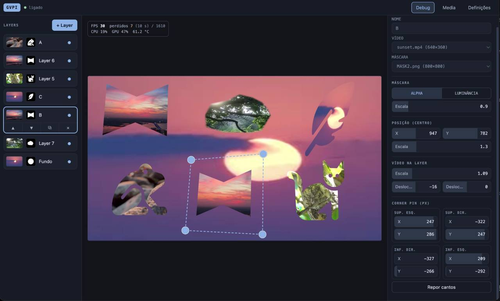

# Raspberry Pi Video Projection Tool

Video Projection Tools for the **Raspberry Pi 5**, there's also a branch adapted to RPI4.



Plays multiple videos, each one with an optional **PNG mask**.
For each video, position, scale and **corner pin** controls.

With full live control from a web panel on your phone or computer.

Project is under development, some polishment is needed.

## How it works

- **Player**: a web page in Chromium (kiosk mode, fullscreen) that draws the layers with plain DOM/CSS.
- **Panel**: a web app served by the Pi. Changes reach the player instantly over WebSocket.
- **Server**: Node.js (Express + ws). Converts uploads with ffmpeg and stores the setup in one JSON file.

The mask defines the layer: its size sets the layer box and the video fills it (*cover*), so swapping the video
never changes the mask. Details in [`docs/MODELO.md`](docs/MODELO.md).

## Install

Raspberry Pi 5, Raspberry Pi OS Bookworm 64-bit (desktop), on your network:

```bash
sudo apt update && sudo apt install -y nodejs npm ffmpeg chromium curl avahi-daemon
cd video-player-rp5/server && npm install --omit=dev
cd .. && deploy/install-service.sh      # starts the server now and on every boot
./kiosk on                              # optional: open the player fullscreen at boot
```

Open the panel from any device on the same network:
`http://<pi-ip>:8080` or `http://<hostname>.local:8080`. 
The address and a QR code also show on the output screen when there are no layers.

## Use

- **Layers**: add, duplicate, delete, reorder, show/hide. Pick a video and a mask for each one.
- **Preview**: drag a layer to move it, drag its 4 handles for the corner pin.
- **Media**: upload videos and PNGs (phone gallery or drag and drop). Videos are converted automatically
  (H.264, max 640×480 or 800×600, constant fps, no audio, HDR to SDR). PNGs become masks.
- **Settings**: output resolution (1920×1080 or 1280×720), conversion size and fps, an option to skip conversion (keep videos as uploaded, e.g. already compressed with HandBrake), optional PIN.
- **Mask drawing**: draw masks (polygon, freehand, ellipse; add/subtract, invert, feather) directly on the preview,
  with the outlines shown live on the HDMI output. Shapes are stored in the layer, no file needed.
- **Debug**: live FPS, dropped frames, CPU, GPU and temperature.

There is **no PIN by default**: anyone on your network can control the screen. Set one in Settings.

## Commands

```bash
sudo systemctl status|restart|stop|start video-server   # the server
journalctl -u video-server -f                           # logs
./kiosk on | off | status                               # open the player at boot (off = normal desktop)
```

## Your data and backup

Everything of yours lives in `data/` (not in git): `config.json` (layers and settings), `media/` (videos and masks).

```bash
tar czf ~/gvpi-backup-$(date +%F).tar.gz data/config.json data/media
```

To restore: `sudo systemctl stop video-server`, put the files back, then `sudo systemctl start video-server`.
The config file is written atomically and the previous version is kept as `config.json.bak`.

## Troubleshooting

- **Panel won't open on a Mac (ping works)**: allow your browser in *System Settings → Privacy & Security →
  Local Network*. Use `http://` (not `https://`) and the `:8080` port.
- **HDMI shows the desktop, not the player**: kiosk is off. Run `./kiosk on` and reboot, or `deploy/kiosk-session.sh &`.
- **Forgot the PIN**: stop the service, set `"pinHash": ""` in `data/config.json`, start the service.
- **Mask looks inverted or the video disappears**: switch the mask mode between *Alpha* and *Luminance*.
- **Stuttering**: turn on **Debug** and check CPU and temperature; use fewer layers or smaller videos.

## Development

```bash
cd server && npm install && npm test    # 30 tests
```

Layout: `server/` (Node server), `public/player/`, `public/panel/`, `public/shared/geometry.js` (used by both),
`deploy/` (service and kiosk scripts), `docs/`, `phase0/` (DOM vs WebGL benchmarks).

On the Pi 5 at 1920×1080 with 640×480@30 videos, 8 masked layers use about 26% CPU and 33% GPU with the DOM
approach (WebGL was heavier), with no throttling.
